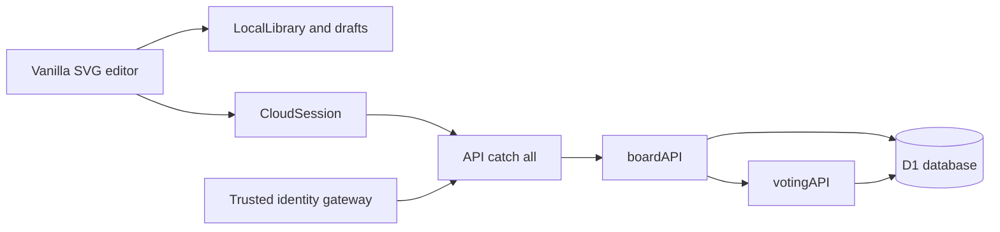

# Architecture

> Provenance: see manifest.json and SOURCE-STATUS.md. Source paths below are relative to this export.

Mirra has a dependency-free browser editor plus a hosted Worker application. The browser editor can be served by the root Node HTTP server. The hosted root uses React/Vinext for authenticated entry, then serves the same editor from static assets. The API catch-all delegates to service functions and a D1 binding. These boundaries come from source/public/index.html, source/public/app.mjs, source/scripts/serve.mjs, source/cloud/app/page.tsx::Home and source/cloud/worker/index.ts::fetch.

Root editor files are copied to cloud/public/public, core modules to cloud/public/src and cloud/lib/core. There is no automatic import alias replacing these copies. Source: source/scripts/sync-cloud.mjs. The exporter never runs that synchronization against the original project.

## Routing map

- Local / serves public/index.html through scripts/serve.mjs.
- Hash #home, #board/<id> and #cloud/<id> are parsed by source/src/navigation.mjs::parseRoute and dispatched by HistoryNavigation.
- Hosted / invokes source/cloud/app/page.tsx::Home, requires a user and redirects to /public/index.html.
- /api/me; /api/boards; /api/boards/:id; /changes; /members; /comments; /presence; /attention; /events are handled in source/cloud/lib/board-service.ts::boardAPI.
- /api/boards/:id/voting and its session/join/ballot/start/end/extend/rename branches are handled in source/cloud/lib/voting-service.ts::votingAPI. Service branches do not imply method exports: the framework entry currently exports GET/POST/PATCH/DELETE only.
- /signin-with-chatgpt, /signout-with-chatgpt and /callback belong to hosting identity infrastructure; local development intercepts them in source/cloud/scripts/vite/sites-vite-plugin.ts::sites.

Request identity is established outside boardAPI and consumed from trusted headers. ctx.props.CONNECTORS is request-scoped; no global cross-user capability cache is used in source/cloud/lib/connector-context.ts::runWithConnectorBinding. The database is SQLite/D1, not the Postgres plan found in historical replica prose. Source: source/cloud/db/schema.ts and source/cloud/db/index.ts::getDb.
