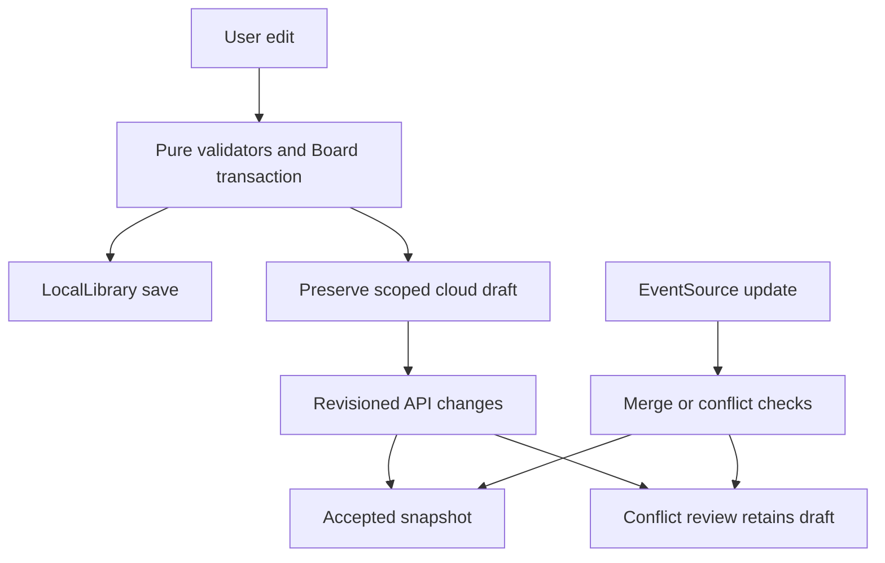

# State and data

> Provenance: see manifest.json and SOURCE-STATUS.md. Source paths below are relative to this export.

## Document and library schemas

A document is {version:1,name,items,...optionalMetadata}. Items use ids/types, x/y/w/h, text/fill and type-specific fields. Recognized types are sticky/text/shape/frame/connector/pen/card/table. Optional tags and timer are validated through dedicated modules. A library is {version:1,revision,boards,spaces,activeId}; a board entry includes its doc, timestamps, starred, spaceId and nullable deletedAt. Sources: source/src/model.mjs::TYPES, validateDocument; source/src/library.mjs::validateLibrary.

Tables use version1, fields and records. Fields support text, number, checkbox, select, date, person and link; a record has id, cells and blockedBy. Actual caps include50 fields and5000 records; links allow HTTP/HTTPS, dates must round-trip as calendar dates, dependencies cannot be missing/self-referential/cyclic. Source: source/src/tables.mjs::FIELD_TYPES, validCell, validateTable.

## Storage inventory

| Key / prefix | Storage | Format / scope / expiry | Source |
| --- | --- | --- | --- |
| mirra.library.v1 | localStorage | Versioned JSON library; no explicit TTL | source/src/library.mjs::LocalLibrary |
| mirra.board.v1 | localStorage legacy | Migration input retained as recovery; no inferred deletion | source/src/library.mjs constructor |
| mirra.device-draft.v2.* | localStorage | JSON; encoded user/board/kind/context | source/src/drafts.mjs::deviceDraftKey, saveCloudDraft |
| mirra.cloud.draft.* | localStorage legacy | Older account-unlabelled draft; explicit export path | source/src/drafts.mjs::readLegacyCloudDraft |
| mirra.cloud-upload.v1.* | localStorage | User/source and digest intent for idempotent creation | source/src/uploads.mjs::uploadIntentKey, prepareCloudUpload |
| mirra.comment.client | sessionStorage | Tab client id; Web Locks isolate duplicates where available | source/src/comment-client.mjs::claimCommentClient; source/public/app.mjs initialization |
| mirra.table-input.v1.* | sessionStorage via editor | Table draft JSON; scoped mode/user/board/table | source/src/table-drafts.mjs::tableDraftKey; source/public/app.mjs::openTable |
| mirra.voting.intent.v1:* | sessionStorage supplied by voting UI | Account/board-scoped uncertain ballot intent | source/src/voting-recovery.mjs::VotingRecovery; source/public/voting-view.mjs |
| mirra.object-text.v1.* | sessionStorage | Object text draft scoped by object/context | source/src/object-drafts.mjs; source/public/object-editor.mjs |
| mirra.board-name.v1.* | sessionStorage | Board name draft | source/src/title-drafts.mjs; source/public/board-title.mjs |
| mirra.properties.v1.* | sessionStorage | Property editing draft | source/public/inspector-recovery.mjs |
| mirra.sidebar.preference | localStorage | {open:boolean,expiresAt:number}; seven days | source/cloud/lib/sidebar-preference.mjs |

Other text/title/property recovery keys are derived by their owning modules; the generated symbol/file inventory identifies those modules. Exact fallback when storage is blocked is handled in the editor and recovery classes; do not assume localStorage is always available. Source: source/public/object-editor.mjs; source/public/board-title.mjs; source/public/inspector-recovery.mjs; source/public/app.mjs.

## Server tables

boards stores document JSON/revisions; board_creations and mutations store idempotency receipts; members stores role grants; presence stores pointers/viewports/follow/attention and timestamps; comments stores threads and soft-deletion fields; api_limits stores expiring counters. voting_sessions, voting_participants and voting_mutations separate session lifecycle, private ballots and receipts. Source: source/cloud/db/schema.ts; source/cloud/drizzle/0000_quick_millenium_guard.sql through0006_easy_jetstream.sql.

## Update and recovery flow

Source: source/public/app.mjs::changed; source/src/cloud-client.mjs::CloudSession; source/src/changes.mjs::applyChanges. Source-controlled JSON consists chiefly of dependency/configuration/migration metadata and theme/test inputs, not production board records. No production database or browser data is exported.
