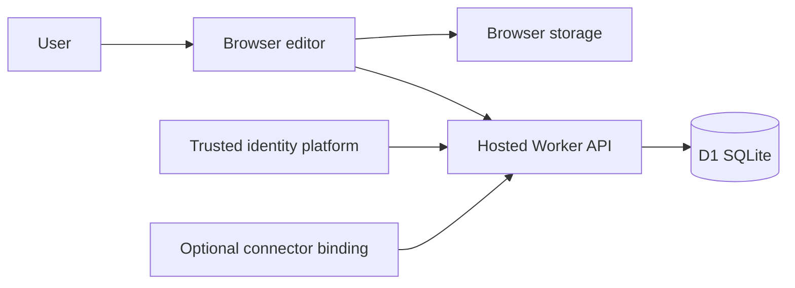
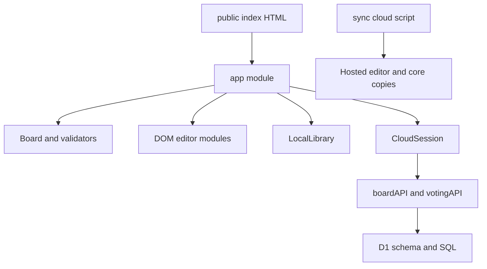
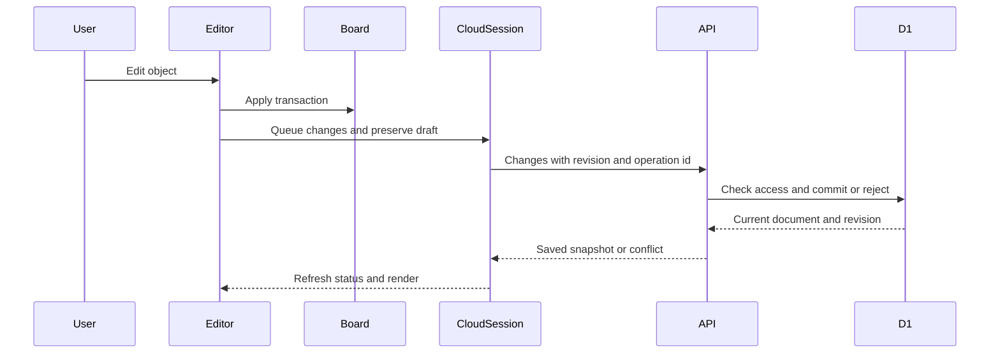

# Mirra technical design

> REVIEW REQUIRED: source changed since narrative review. Read SOURCE-STATUS.md; do not treat prior validation as current.

## 1. Document control

| Field | Value |
| --- | --- |
| Name | Mirra Technical Design |
| Document version | 1.0 |
| Application version | 0.1.0 |
| Generated on | 2026-11-09T10:43:20.623Z |
| Source branch | main |
| Source commit | 8a4caead31ebf2e7a6017a54ff0ae35b65dda246 |
| Content fingerprint | 4f66e02b6b82d32809f50911ff75f9ab9e366dddc7fb4ca40264afcd3ee4da03 |

Document version1.0; generated date, source branch, commit and content fingerprint are recorded in manifest.json and SOURCE-STATUS.md. The snapshot is sanitized; configuration placeholders are listed in reference/config-reference.md. A dirty working tree is represented by per-file hashes and status, not falsely attributed entirely to a commit. Sources: manifest.json; reference/source-inventory.json.

## 2. Executive summary

Mirra is a visual workspace for creating and arranging boards of ideas, diagrams and typed records. Source-supported user roles include a device-local user and cloud owner/editor/commenter/viewer. The browser can operate without a backend for local boards; hosted persistence adds identity, membership, revisioned mutations and live activity. Full Miro parity, deployed integrations and production operational SLOs are not established. Sources: source/README.md; source/public/index.html; source/cloud/lib/board-service.ts::boardAPI; source/GATES.md.

## 3. Functional overview

The dashboard organizes boards by recency, stars, spaces and trash. Canvas tools create sticky notes, text, shapes, frames, connectors, pen strokes, cards and tables. Selection supports properties, alignment, grouping, duplication, locks and deletion. Import/export uses editable JSON and SVG; malformed input is validated before replacement. Cloud flows cover board creation/access, comments, role grants, presence/following and activity streams. Facilitation modules cover timers and voting; native production voting has an identified HTTP-method routing gap. Sources: source/public/app.mjs; source/src/model.mjs::TYPES, Board; source/public/board-import.mjs::prepareBoardImport; source/cloud/lib/board-service.ts; source/cloud/lib/voting-service.ts; docs/behavior.md.

## 4. Architecture

These diagrams show code boundaries, not separately deployed microservices. | Layer | Technology | Locked version / requirement | Purpose |
| --- | --- | --- | --- |
| Editor | HTML/CSS/ES modules/SVG | Browser-native | Editor implementation/tooling; see cited manifest/import inventory |
| Runtime | Node.js | >=24 (root); >=22.13.0 (cloud) | Runtime implementation/tooling; see cited manifest/import inventory |
| Cloud framework | vinext | [UNVERIFIED] | Cloud framework implementation/tooling; see cited manifest/import inventory |
| Framework compatibility | next | [UNVERIFIED] | Framework compatibility implementation/tooling; see cited manifest/import inventory |
| Build | vite | [UNVERIFIED] | Build implementation/tooling; see cited manifest/import inventory |
| Cloud UI | react | [UNVERIFIED] | Cloud UI implementation/tooling; see cited manifest/import inventory |
| Cloud UI | react-dom | [UNVERIFIED] | Cloud UI implementation/tooling; see cited manifest/import inventory |
| Types | typescript | [UNVERIFIED] | Types implementation/tooling; see cited manifest/import inventory |
| Cloud CSS | tailwindcss | [UNVERIFIED] | Cloud CSS implementation/tooling; see cited manifest/import inventory |
| Database | drizzle-orm | [UNVERIFIED] | Database implementation/tooling; see cited manifest/import inventory |
| Migrations | drizzle-kit | [UNVERIFIED] | Migrations implementation/tooling; see cited manifest/import inventory |
| Worker tooling | wrangler | [UNVERIFIED] | Worker tooling implementation/tooling; see cited manifest/import inventory |
| Lint | eslint | [UNVERIFIED] | Lint implementation/tooling; see cited manifest/import inventory |
| Installed validation library | zod | [UNVERIFIED] | Installed validation library implementation/tooling; see cited manifest/import inventory |
| Locally patched glob engine | picomatch | [UNVERIFIED] | Locally patched glob engine implementation/tooling; see cited manifest/import inventory |
| Locally hardened brace engine | braces | [UNVERIFIED] | Locally hardened brace engine implementation/tooling; see cited manifest/import inventory |

Source: source/package.json; source/cloud/package.json; source/cloud/package-lock.json. Detailed import evidence is reference/dependencies.md. | Route | Page/module | Purpose |
| --- | --- | --- |
| / | source/cloud/app/page.tsx::Home | Authenticated hosted redirect |
| /public/index.html | source/public/index.html::HTML | Static board editor |
| #home | source/src/navigation.mjs::parseRoute | Dashboard hash route |
| #board/<id> | source/src/navigation.mjs::parseRoute | Device board hash route |
| #cloud/<id> | source/src/navigation.mjs::parseRoute | Cloud board hash route |
| /api/[...path] | source/cloud/app/api/[...path]/route.ts::handle | Framework GET/POST/PATCH/DELETE; PUT absent |
| /api/me | source/cloud/lib/board-service.ts::boardAPI | Service branch; method/access checks apply |
| /api/boards | source/cloud/lib/board-service.ts::boardAPI | Service branch; method/access checks apply |
| /api/boards/:id | source/cloud/lib/board-service.ts::boardAPI | Service branch; method/access checks apply |
| /api/boards/:id/changes | source/cloud/lib/board-service.ts::boardAPI | Service branch; method/access checks apply |
| /api/boards/:id/members | source/cloud/lib/board-service.ts::boardAPI | Service branch; method/access checks apply |
| /api/boards/:id/comments | source/cloud/lib/board-service.ts::boardAPI | Service branch; method/access checks apply |
| /api/boards/:id/comments/:commentId | source/cloud/lib/board-service.ts::boardAPI | Service branch; method/access checks apply |
| /api/boards/:id/comments/:commentId/resolve | source/cloud/lib/board-service.ts::boardAPI | Service branch; method/access checks apply |
| /api/boards/:id/presence | source/cloud/lib/board-service.ts::boardAPI | Service branch; method/access checks apply |
| /api/boards/:id/attention | source/cloud/lib/board-service.ts::boardAPI | Service branch; method/access checks apply |
| /api/boards/:id/events | source/cloud/lib/board-service.ts::boardAPI | Service branch; method/access checks apply |
| /api/boards/:id/voting/* | source/cloud/lib/voting-service.ts::votingAPI | Voting service branches; PUT framework integration unresolved |

The same route map is in manifest.json and docs/architecture.md. Sources: source/scripts/sync-cloud.mjs; source/cloud/worker/index.ts::fetch; source/cloud/app/page.tsx::Home; source/cloud/app/api/[...path]/route.ts::handle.

## 5. UI design

The editor is an HTML dashboard plus a full-window SVG canvas with floating board actions, creation tools, selection actions, zoom/undo controls, panels and native dialogs. DOM modules receive host elements and callbacks rather than React props. TableEditor receives accessors for the current item, commit/rename/create-card callbacks, writable checks, draft storage and undo. ObjectTextEditor and BoardTitleEditor manage edit/recovery flows. React RootLayout and starter UI components form a distinct layer and are not the canvas component hierarchy. Forms validate names, numeric geometry, styles, table cell types and conflict baselines. Sources: source/public/index.html; source/public/app.mjs::openTable, edit; source/public/table-editor.mjs::TableEditor; source/public/object-editor.mjs::ObjectTextEditor; source/public/board-title.mjs::BoardTitleEditor; source/cloud/app/layout.tsx::RootLayout. See docs/ui-and-components.md.

## 6. State and data

Board documents use version1 with name/items and optional timer/tags. Items have bounded geometry, stable ids and recognized types. LocalLibrary stores a version1 snapshot with revision, boards, spaces and activeId. A board entry contains a document and lifecycle metadata. Cloud boards store JSON documents and revisions in D1; membership, operation receipts, presence, comments, limits and voting use separate tables. Client drafts are intentionally separate from the durable document and scoped to account/board/tab where applicable. Sources: source/src/model.mjs::validateDocument; source/src/library.mjs::validateLibrary, LocalLibrary; source/src/drafts.mjs::deviceDraftKey; source/cloud/db/schema.ts.

This is a conceptual flow; local-only editing persists through LocalLibrary instead. Storage keys, formats and expiry are detailed in docs/state-and-data.md. No IndexedDB implementation was identified in the inspected core/editor source.

## 7. Application logic

Board operations validate documents and preserve undo transaction boundaries. Frame containment uses frame-index and reconcileFrames rather than unchecked recursive ancestry. Connector geometry resolves endpoints and routes shapes; selection and bounds support transforms/export. changesBetween creates field-level operations; applyChanges checks before-values and throws Conflict instead of blindly overwriting peer work. Cloud creation uses a SHA256 digest and persisted operation intent. Voting validates budgets and private/public projections separately from board JSON. Sources: source/src/model.mjs::Board, reconcileFrames; source/src/frame-index.mjs; source/src/geometry.mjs; source/src/changes.mjs::changesBetween, applyChanges, Conflict; source/src/uploads.mjs::prepareCloudUpload; source/src/voting.mjs::validateBallot, votingView.

Errors surface through status elements, dialog errors and toasts; failed persistence preserves available in-memory work and recovery paths. Sources: source/public/app.mjs::toast; source/src/save-status.mjs; source/public/inspector-recovery.mjs.

## 8. Styling and UX

The editor loads style.css then design.css. Custom properties define backgrounds, surfaces, text, accent, radius, shadow and font. The later design layer uses a blue accent and dark dashboard navigation; SVG object styling is separate document data. Responsive rules include1000px,850px,600px and520px adjustments and short-height cases. Reduced-motion rules disable transitions/animations. Native buttons/forms/dialogs, labels, status/alert roles, SVG focus and keyboard bindings provide accessibility affordances; a complete screen-reader, contrast and browser-compatibility certification is [UNVERIFIED]. Cloud React Tailwind tokens include a separate dark theme and do not prove the editor has a dark-mode toggle. Sources: source/public/style.css; source/public/design.css; source/public/index.html; source/cloud/app/globals.css; docs/styling.md.

## 9. External dependencies and services

The root editor loads local modules/styles and calls same-origin /api endpoints. Cloud authentication depends on hosting-provided identity headers and sign-in/sign-out routes. D1 is required for server data; connectors are optional request-scoped bindings, not a catalog of implemented integrations. No runtime analytics/CDN-font integration was identified in the inspected editor entry points. Network failures preserve drafts and show reconnect/conflict/error status rather than certify offline cloud writes. Runtime dependency purposes and examples are in docs/external-services.md; exact direct dependency versions are in reference/dependencies.md. Sources: source/src/cloud-client.mjs::cloudRequest, CloudSession; source/cloud/app/chatgpt-auth.ts; source/cloud/lib/connectors.ts::connectorsForRequest; source/cloud/db/index.ts::getDb.

## 10. Security

validateDocument and typed table validation reject malformed documents and unsafe link schemes. Board API checks trusted identity, expected client identity, same-origin writes, server role access and per-minute write limits. readJSONObject enforces a4MB UTF8 JSON-object boundary. SQL uses prepared bindings for dynamic values; inspect individual query branches before extensions. Shared CSP/HSTS/nosniff headers cover application responses and static assets; preview connector JSON endpoints use deny-all CSP. Display text is created through DOM text/value APIs and SVG attributes; this is not a claim that arbitrary HTML is supported. Sources: source/src/model.mjs::validateDocument; source/src/tables.mjs::validCell; source/cloud/lib/request-body.ts::readJSONObject; source/cloud/lib/board-service.ts::boardAPI; source/src/security-headers.mjs::securityHeaders; source/cloud/public/_headers; source/cloud/scripts/vite/connector-preview-plugin.mjs.

Browser storage contains document and draft contents, which remain readable to same-origin JavaScript; do not store service credentials there. Sidebar display state uses localStorage rather than an authentication cookie. Local development auth cookies are separate loopback fixtures. Locally patched dependencies retain licenses and evidence; zero npm audit is not Checkmarx certification. Sources: source/cloud/lib/sidebar-preference.mjs; source/cloud/scripts/vite/sites-vite-plugin.ts; source/cloud/vendor/SECURITY-PATCHES.md. Current exported-copy results belong in verification/report.json.

## 11. Performance

The root editor is native ES modules and SVG without a bundle step. The hosted React/framework layer is built into client/server assets. SVG rendering cost depends on object count and interaction path; document limits are safeguards, not performance promises. The server events endpoint polls D1 on a timer and renews connections, which has database/read cost as concurrency grows. Local static preview uses no-store; API JSON responses and SSE define explicit cache behavior. Actual exported build sizes are measured in verification/report.json rather than estimated here. No load-test throughput, production cache-hit ratio or supported concurrent-user count is established. Sources: source/public/app.mjs::render; source/src/model.mjs::MAX_BOARD_ITEMS; source/cloud/lib/board-service.ts::boardAPI events branch; source/scripts/serve.mjs; source/cloud/package.json.

## 12. Build and deployment

Use Node24+ and npm. Device-only: cd source, npm run dev. Full app: cd source/cloud, npm run install:ci, apply local migrations with the exact Wrangler command in docs/setup-and-deployment.md, npm run dev. From source run npm test; from source/cloud run npx tsc --noEmit, npm run build and npm run start. The start command uses the generated dist/server/wrangler.json. npm run lint is available but not silently represented as passing. Production hosting is Sites-managed Cloudflare Workers with D1; the repository alone does not provision the production identity gateway or grant hosting access. Deployment requires configuration placeholders and the official Sites tooling. Sources: source/package.json; source/cloud/package.json; source/cloud/scripts/install-ci.mjs; source/cloud/scripts/run-framework.mjs; source/cloud/vite.config.ts; source/cloud/README.md.

## 13. Testing

Root tests use node:test, strict assertions and SQLite fixtures to exercise model, recovery, APIs and security. Tests importing cloud dependencies require installation in source/cloud first. Python theme validation tests require Python3 and the included isolated skill utility. Focused scale scripts exist for frame validation, containment and descendant selection; they are not production load tests. Export verification runs record command status, source fingerprint and output logs. Browser/platform sign-in, native keyboard flows and fully deployed concurrency remain separate acceptance gaps. Sources: source/tests/; source/scripts/check-frame-validation-scale.mjs; source/scripts/check-frame-containment-scale.mjs; source/tests/review-theme-bounds.py; source/GATES.md.

## 14. Known issues and technical debt

The catch-all API route omits PUT while VotingClient/votingAPI use PUT for ballots; the exporter preserves this mismatch. Copied modules can drift if synchronization is skipped. A large app.mjs owns much editor orchestration. Historical architecture docs contain unimplemented plans. Hosting/publication depends on tools outside this repository. Local dependency patches carry maintenance obligations. Unchecked acceptance gates are not automatically bugs, but they are not verified completion either. TODO/FIXME matches are inventoried separately in reference/code-markers.md and can include upstream vendor comments. Sources: source/cloud/app/api/[...path]/route.ts; source/src/voting-client.mjs; source/cloud/lib/voting-service.ts; source/scripts/sync-cloud.mjs; source/replica/architecture.md; source/GATES.md; source/cloud/vendor/SECURITY-PATCHES.md.

## 15. Open questions

See docs/open-questions.md. Production access configuration, latest security scan closure, end-to-end hosted voting, comprehensive accessibility/browser support and complete feature parity are [UNVERIFIED]. Automatic inventory refresh does not resolve these questions. Human review is required for changed narrative claims.

## 16. Change history

reference/change-history.md contains a sanitized bounded Git log. Descriptive commits include adding audited cloud source and lockfile to security scanning and fixing sidebar preferences, preview headers and braces recursion. Generic commit subjects do not establish a design rationale. This document separates source-observed decisions from inferred motives. Sources: Git history captured in reference/change-history.md; docs/decisions-log.md.
